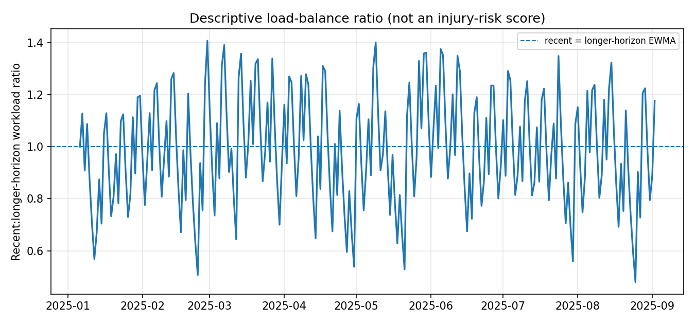
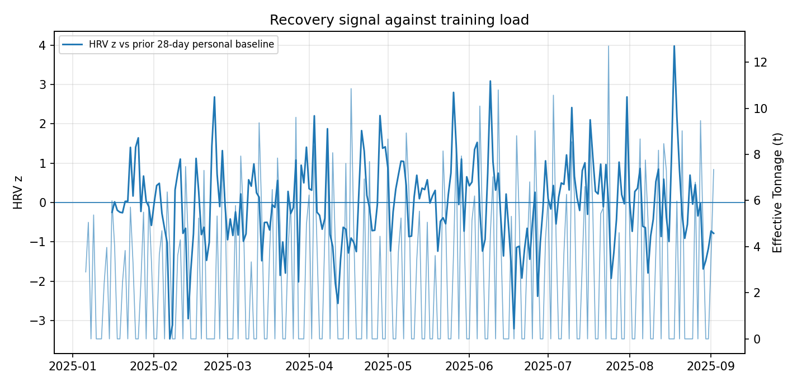
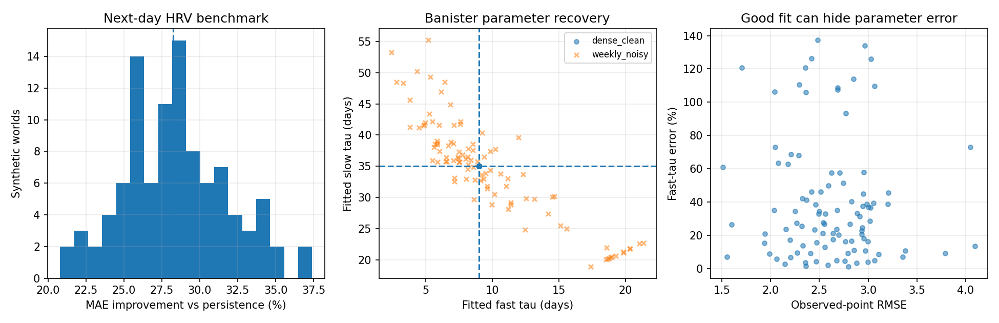

# Training-Recovery Modelling & Identifiability Laboratory

[](https://github.com/AhmadEblagh205/training-recovery-analytics/actions/workflows/ci.yml)


I originally built this because I already record every gym set in Hevy and recovery signals in Apple Health. The interesting problem is not drawing another fitness dashboard; it is deciding what those measurements can actually support.

The repository therefore combines a **local personal-data pipeline** with **checked-in synthetic known-truth experiments**. It covers training-load summaries, causal personal baselines, one-day-ahead HRV prediction and a Banister-style fitness-fatigue model, but the public numerical evidence comes from controlled synthetic data. My raw health data stay outside git.

The audit changed the centre of gravity of the project: it is now as much about **model validity and identifiability** as it is about training analytics.

## The core questions

1. Can a pipeline recover a training-to-recovery relationship when that relationship is deliberately planted in synthetic data?
2. Can a dynamic fitness-fatigue model recover its true time constants under ideal data?
3. What happens to those parameters when observations become sparse and noisy?
4. Which quantities are descriptive heuristics, and which would require stronger evidence before they should drive real decisions?

That last distinction matters. This is an analytics/model-validation project, **not an injury predictor, medical device or validated coaching system**.

## Data pipeline

### Hevy

`ingest.py` validates the set export, maps exercises to broad muscle groups and computes:

- plain tonnage;
- an explicitly heuristic RPE-weighted `effective_tonnage`;
- session-level Epley estimated 1RM trajectories;
- strict estimated-PR improvements;
- weekly muscle-group volume.

Missing RPE falls back to 8 so the weighted metric equals plain tonnage. Invalid negative loads/reps, impossible RPE values, duplicate set rows and missing required columns fail loudly.

### Apple Health

Apple Health `export.xml` is streamed rather than loaded wholesale. The parser extracts:

- HRV SDNN;
- resting heart rate;
- asleep intervals.

Sleep duration uses the timezone-aware timestamps and overlapping asleep records are merged before summation, avoiding double counting from overlapping sleep-stage/source records. Overnight sleep is attributed to the local calendar date on which it ends.

## Training load: useful descriptor, not an injury score

The repo retains the familiar `acwr` function name for compatibility, but its interpretation has changed materially after audit.

It computes a ratio between a short and longer exponentially weighted load history. I use that as a **descriptive recent-to-baseline load-balance signal**. I do **not** claim that `0.8–1.3` is a universal “sweet spot”, that `>1.3` causes injury, or that manipulating the ratio has been shown to prevent injury.

That is intentional: methodological work has highlighted ratio artefacts, confounding and the absence of established causal evidence for using ACWR as an injury-prevention prescription. A recent meta-analysis still found associations in heterogeneous observational studies, but also explicitly called for cautious interpretation because calculation methods and study designs differ substantially.



## Recovery features are causal

Morning HRV, resting HR and sleep are expressed relative to the athlete's **previous 28 days**. Today's observation is not allowed to help define its own baseline.

The project readiness score is transparent:

`HRV z - 0.5 × resting-HR z + 0.5 × sleep z`

but it is deliberately labelled a **project heuristic**, not a validated physiological index.

The lag diagnostic asks whether load on day `t` is associated with HRV on `t + k`. On the checked-in synthetic athlete, the strongest planted relationship is at one day, with lag-1 correlation about **-0.40**. This is a recovery of the synthetic mechanism, not a causal estimate from a real athlete.



## Next-day HRV prediction: leakage-aware known-truth test

A ridge model uses today's:

- causal load z-score;
- sleep z-score;
- HRV z-score;
- recent-to-baseline load ratio.

Evaluation uses expanding `TimeSeriesSplit`, a **one-day embargo** because the target is tomorrow's HRV, and feature scaling fitted inside each training fold. The baseline is persistence: tomorrow's recovery state equals today's.

Across **100 independently generated synthetic athletes**:

- median MAE improvement vs persistence: **28.25%**;
- 5th–95th percentile improvement: **22.68–34.21%**;
- full model beats persistence: **100/100 worlds**;
- full model beats a recovery-only model without load features: **100/100 worlds**;
- median lag-1 load/HRV correlation: **-0.424**;
- the standardised load coefficient is negative in **100/100 worlds**.

Those numbers are a **code/estimator validation** because the generator was constructed to contain a training-load effect. They are not evidence that a real person's HRV can be predicted this accurately.

## The mechanistic heart: fitting is not identification

The Banister-style model is

\[
P(t)=p_0+k_1\sum_s w(s)e^{-(t-s)/\tau_1}
-k_2\sum_s w(s)e^{-(t-s)/\tau_2},
\]

with a slower fitness store and a faster fatigue store. The fitter now enforces `tau_slow > tau_fast` and uses deterministic multi-start nonlinear least squares so one arbitrary initial guess is less likely to dictate the answer.

The important audit is not the prettiest fitted curve. It is a repeated known-truth experiment.

### Dense, noiseless observations

Truth:

- slow time constant: **35 days**;
- fast time constant: **9 days**.

Across 100 worlds with observations every two days and no observation noise, both time constants are recovered exactly. That is a code-recovery check.

### Weekly, noisy observations

With observations every seven days and noise SD = 3 performance units:

- slow tau median: **35.73 days**;
- slow tau 5th–95th percentile: **20.48–48.48 days**;
- fast tau median: **8.31 days**;
- fast tau 5th–95th percentile: **4.34–19.87 days**;
- median relative error: **13.0%** slow tau, **27.6%** fast tau.

So a reasonable-looking model fit can coexist with materially uncertain parameters. That is the key bridge to my doctoral work on practical identifiability and informative experiment design.

The ordinary end-to-end synthetic-athlete fit is intentionally **not** presented as a parameter-recovery result: realised set tonnage is only a proxy for the latent training impulse used by the generator. In the checked-in run one gain parameter reaches its optimisation bound, which is a diagnostic warning rather than a physiological discovery.



## Transparent planning heuristic

The repo still demonstrates how analysis can be converted into an inspectable decision rule. The session suggestion combines:

- the transparent readiness heuristic;
- the recent-to-baseline load ratio;
- muscle-group volume relative to the **preceding** 28-day weekly average.

Every branch returns its reasons and an explicit status string saying that it is an illustrative planning heuristic, not injury or medical advice. The point is software transparency, not evidence that the rule is an optimal training prescription.

## Weekly report

`report.py` writes a markdown summary with:

- last-seven-day muscle-group volume vs the preceding 28-day weekly average;
- the recent-to-baseline load ratio in neutral descriptive language;
- current key-lift e1RM estimates;
- an inspectable planning flag.

The old “sweet spot / spike territory / cut volume” language has been removed.

## Usage

```bash
pip install -r requirements.txt

# Main checked-in synthetic pipeline
python src/run.py --synthetic
python src/report.py --synthetic

# Known-truth statistical/model audits
python src/audit.py --worlds 100

# Local personal-data path; raw exports remain gitignored
python src/run.py --hevy data/raw/workouts.csv --apple data/raw/export.xml
python src/report.py --hevy data/raw/workouts.csv
```

The CLI now fails closed if real-data mode is only partially specified; it no longer silently substitutes synthetic data.

## Tests

**19 pytest tests pass**, covering:

- Epley estimates and strict PR logic;
- Hevy schema/value validation and RPE weighting;
- streamed Apple Health parsing, timezone-aware sleep duration and overlap merging;
- causal/future-safe rolling baselines;
- steady-load ratio behaviour;
- ordered Banister parameter recovery and noisy fits;
- one-day-embargoed next-day prediction;
- future-safe load features;
- non-overlapping volume baselines;
- transparent recommender branches/caveat;
- neutral weekly-report language;
- small known-truth regression versions of both major audit experiments.

## What this project does **not** establish

It does not establish:

- an injury-risk threshold;
- that ACWR manipulation prevents injury;
- that the readiness formula is clinically or physiologically validated;
- that a real athlete's next-day HRV will achieve the synthetic benchmark accuracy;
- that fitted Banister time constants are literal physiological constants;
- that the planning heuristic is a safe or optimal training prescription.

## Methodology and references

See [`docs/METHODOLOGY.md`](docs/METHODOLOGY.md) for the formulas, validation logic and methodological caveats.

Key references used in the audit include:

- Impellizzeri FM et al. **Acute:Chronic Workload Ratio: Conceptual Issues and Fundamental Pitfalls.** *International Journal of Sports Physiology and Performance* (2020). PMID 32502973.
- Wang C et al. **Acute to chronic workload ratio (ACWR) for predicting sports injury risk: a systematic review and meta-analysis.** (2025). PMID 41029871.
- Vanrenterghem J et al. **The Fitness-Fatigue Model: What's in the Numbers?** *International Journal of Sports Physiology and Performance* (2022). PMID 35320776.
- Hellard P et al. **Assessing the limitations of the Banister model in monitoring training.** *Journal of Sports Sciences* (2006). PMID 16608765.
- A recent Bayesian re-analysis, **Statistical flaws of the fitness-fatigue sports performance prediction model**, illustrates ill-conditioning, poor parameter identifiability and the distinction between fit and prediction. PMID 39881202.

## Licence

MIT, see [LICENSE](LICENSE).
